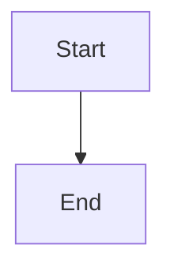

# Markora - Modern Markdown Editor

A production-ready, feature-rich Markdown writing and document editor built with React, TypeScript, and Tailwind CSS.

## Features Implemented

### Core Functionality
- ✅ Markdown editor with textarea (ready to upgrade to CodeMirror)
- ✅ Live preview with react-markdown
- ✅ Split editor/preview layout with toggle modes
- ✅ Syntax highlighting in preview
- ✅ Mermaid diagram rendering
- ✅ Custom content blocks (note, tip, warning)
- ✅ Wiki-style links `[[Page Name]]`
- ✅ Task list support with interactive checkboxes

### Document Management
- ✅ Create, open, rename, delete documents
- ✅ Document sidebar with search
- ✅ Multiple document support
- ✅ Auto-save with dirty state tracking
- ✅ localStorage persistence

### Editing Tools
- ✅ Formatting toolbar with all common Markdown actions
- ✅ Keyboard shortcuts (Cmd/Ctrl+B, Cmd/Ctrl+I, Cmd/Ctrl+K)
- ✅ Drag-and-drop image support
- ✅ Search and replace panel
- ✅ Template picker with 6 pre-built templates

### Customization
- ✅ Settings sidebar
- ✅ Page layout settings (size, orientation, margins)
- ✅ Header and footer configuration
- ✅ Typography controls (font family, size, line height)
- ✅ Theme modes (light, dark, sepia)

### Export & Productivity
- ✅ Export to HTML
- ✅ Export to PDF (placeholder for implementation)
- ✅ Command palette (Cmd/Ctrl+K)
- ✅ Focus mode
- ✅ Document history/versioning

## Architecture

### File Structure
```
src/
├── app/
│   ├── App.tsx (main entry with store initialization)
│   └── components/ui/ (shadcn components)
├── pages/
│   └── EditorPage.tsx (main editor layout)
├── features/
│   ├── documents/ (sidebar, document management)
│   ├── editor/ (markdown editor, toolbar)
│   ├── preview/ (preview, mermaid, code blocks)
│   ├── settings/ (settings sidebar with sections)
│   ├── command-palette/ (command palette)
│   ├── search/ (search & replace)
│   ├── export/ (export modals & utilities)
│   ├── templates/ (template picker & data)
│   └── history/ (version history panel)
├── stores/
│   ├── documentStore.ts (document CRUD)
│   ├── editorStore.ts (editor mode, focus mode)
│   ├── settingsStore.ts (all settings)
│   ├── uiStore.ts (modal/sidebar state)
│   └── historyStore.ts (version history)
├── lib/
│   ├── markdown/ (parser, actions, mermaid)
│   ├── storage/ (localStorage utilities)
│   └── utils/ (cn, ids, dates, debounce)
└── types/
    └── common.types.ts (all TypeScript types)
```

### State Management
Uses Zustand with 5 separate stores:
- **documentStore**: Documents, folders, active document
- **editorStore**: Editor mode, selection, focus mode
- **settingsStore**: Page, typography, theme settings
- **uiStore**: Modal and sidebar visibility
- **historyStore**: Document version history

### Key Components
- **EditorPage**: Main layout orchestrator
- **TopBar**: Document title, mode switcher, action buttons
- **DocumentSidebar**: File tree with search and actions
- **EditorToolbar**: Formatting actions with tooltips
- **MarkdownEditor**: Controlled textarea with drag-drop
- **MarkdownPreview**: React-markdown with custom renderers
- **SettingsSidebar**: Modular settings sections
- **CommandPalette**: Keyboard-first command interface

## Technologies Used

### Core
- React 18.3.1
- TypeScript
- Tailwind CSS v4
- Vite 6.3.5

### State & Data
- Zustand 5.0.13 (state management)
- localStorage (persistence)
- nanoid (ID generation)
- date-fns (date formatting)

### Markdown
- react-markdown 10.1.0
- remark-gfm 4.0.1
- rehype-raw 7.0.0
- rehype-sanitize 6.0.0
- mermaid 11.15.0
- marked 18.0.4 (HTML export)

### UI Components
- Radix UI (headless components)
- lucide-react (icons)
- cmdk (command palette)
- sonner (toasts - available)

## Keyboard Shortcuts

- `Cmd/Ctrl + K` - Open command palette
- `Cmd/Ctrl + F` - Open search & replace
- `Cmd/Ctrl + B` - Toggle bold
- `Cmd/Ctrl + I` - Toggle italic
- `Esc` - Close modals/panels

## Custom Markdown Syntax

### Wiki Links
```markdown
[[Page Name]]
```

### Custom Blocks
```markdown
::: note
This is a note block
:::

::: tip
Pro tip content
:::

::: warning
Warning message
:::
```

### Mermaid Diagrams
````markdown

````

## Future Enhancements (Phase 2)

- [ ] Inline comments system
- [ ] Real-time collaboration
- [ ] AI writing tools
- [ ] WYSIWYG mode toggle
- [ ] Plugin system
- [ ] Visual table editor
- [ ] Outline drag/restructure
- [ ] Readability scores
- [ ] Timeline version view
- [ ] CodeMirror 6 integration for better editor

## Development Notes

### Modular Architecture
- Each feature is self-contained in its own folder
- Stores are separated by concern
- Utilities are pure functions
- Types are centralized

### Extensibility
- Toolbar actions are config-driven
- Commands are registered in a config file
- Templates are data-driven
- Easy to add new markdown actions

### Performance
- Debounced auto-save
- Lazy mermaid rendering
- Virtualized lists ready (if needed)
- Optimistic UI updates

### Code Quality
- TypeScript strict mode
- No `any` types used
- Barrel exports for clean imports
- Consistent naming conventions
- Separation of concerns

## Usage

The app auto-initializes all stores from localStorage on mount. A welcome document is created if no documents exist.

1. **Create documents** - Click + in sidebar
2. **Edit Markdown** - Type in left panel
3. **Preview** - See rendered output in right panel
4. **Format** - Use toolbar or keyboard shortcuts
5. **Settings** - Click settings icon to customize
6. **Export** - Click export icon for HTML/PDF
7. **Templates** - Open command palette or templates modal
8. **Search** - Cmd/Ctrl+F to find/replace

## Notes

- This is a Figma Make project - do not run `vite build` manually
- The dev server is already running via Figma
- All persistence uses localStorage (no backend needed for MVP)
- PDF export uses browser print API placeholder
- Ready for CodeMirror/Monaco editor upgrade by replacing MarkdownEditor component
